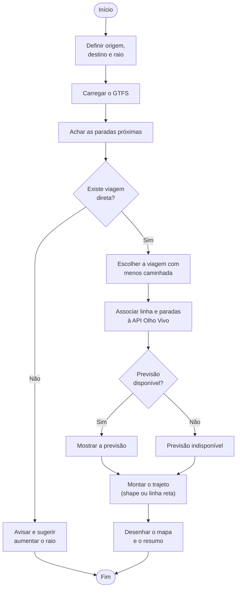
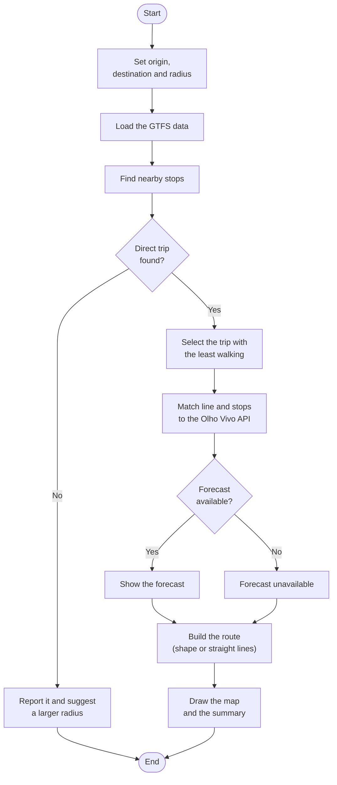

<a name="portugues"></a>

# Projeto Transporte

**Recomendação de viagem direta de ônibus em São Paulo, usando dados GTFS da SPTrans e a API Olho Vivo em tempo real**

Português (Brasil) | [English](#english-version)


[Abrir no Google Colab](https://colab.research.google.com/github/SEU-USUARIO/Projeto-Transporte/blob/desenvolvimento/note_principal.ipynb)

---

## Índice

- [Visão geral](#visão-geral)
- [Funcionalidades](#funcionalidades)
- [Como funciona](#como-funciona)
- [Fontes de dados](#fontes-de-dados)
- [Tecnologias](#tecnologias)
- [Estrutura do projeto](#estrutura-do-projeto)
- [Como começar](#como-começar)
- [Como usar](#como-usar)
- [Roteiro do notebook](#roteiro-do-notebook)
- [Decisões de projeto](#decisões-de-projeto)
- [Limitações](#limitações)
- [Solução de problemas](#solução-de-problemas)
- [Próximos passos](#próximos-passos)
- [Créditos e termos dos dados](#créditos-e-termos-dos-dados)
- [Licença](#licença)

---

## Visão geral

O Projeto Transporte é um projeto acadêmico de análise de dados em Python. A partir de uma origem e de um destino na cidade de São Paulo, ele recomenda uma **viagem direta de ônibus** (sem baldeação), mostra o trajeto em um **mapa interativo** e, quando disponível, informa a **previsão de chegada do próximo ônibus** no ponto de embarque.

O projeto combina duas fontes de dados da SPTrans, a empresa de transporte público de São Paulo:

- **GTFS**, o conjunto de dados estáticos, que descreve linhas, viagens, paradas e trajetos.
- **API Olho Vivo**, um serviço em tempo real que fornece a posição dos veículos e as previsões de chegada.

Ele roda como um notebook Jupyter no Google Colab e foi desenvolvido como projeto de aprendizado em análise de dados, integração com APIs e visualização geográfica.

## Funcionalidades

- Encontra paradas de ônibus dentro de um raio de caminhada configurável, perto da origem e do destino.
- Relaciona as tabelas do GTFS (`routes`, `trips`, `stop_times`, `stops`) para identificar **viagens diretas**, em que o destino vem depois da origem na sequência de paradas.
- Ordena as opções pela **distância total de caminhada** (origem até o embarque mais desembarque até o destino) e recomenda a melhor. Também é possível escolher uma linha específica.
- Faz a correspondência entre a linha e as paradas do GTFS e as da API Olho Vivo pelo letreiro da linha e pela proximidade geográfica, em vez de presumir que os identificadores dos dois sistemas são iguais.
- Consulta a **previsão de chegada do próximo ônibus** para o ponto de embarque e a linha recomendados.
- Desenha um **mapa interativo** com origem, destino, embarque, desembarque, paradas intermediárias numeradas, trajeto da linha e legenda.
- Trata falhas de forma explícita: ausência de viagem direta, trajeto ausente no `shapes.txt`, erros da API, respostas vazias e previsão indisponível. Em cada caso o notebook explica o que aconteceu e continua mostrando o restante da recomendação.
- Imprime um **resumo de verificações** ao final de cada execução.

## Como funciona

1. O usuário define uma origem, um destino e um raio de busca.
2. O notebook carrega os arquivos do GTFS e encontra as paradas perto da origem e perto do destino, usando a distância de Haversine.
3. Relaciona as tabelas do GTFS e mantém as viagens que passam perto da origem e, depois, perto do destino.
4. Seleciona a viagem com a menor distância total de caminhada.
5. Encontra a mesma linha na API Olho Vivo, escolhe o sentido correto comparando a localização das paradas e valida a correspondência.
6. Solicita a previsão de chegada para o ponto de embarque e a linha validados.
7. Monta o trajeto (shape oficial ou, se indisponível, uma aproximação em linha reta entre as paradas), desenha o mapa e imprime o resumo da recomendação.



## Fontes de dados

| Fonte | Conteúdo | Uso no projeto |
|---|---|---|
| GTFS (SPTrans) | Linhas, viagens, paradas, sequência de paradas e trajetos | Encontrar viagens diretas e desenhar o trajeto |
| API Olho Vivo (SPTrans) | Busca de linhas, paradas por linha, previsões de chegada em tempo real | Validar linhas e paradas e informar horários de chegada |
| Esri e OpenStreetMap | Tiles de mapa (fundo) | Fundo do mapa |

## Tecnologias

- Python 3
- [pandas](https://pandas.pydata.org/) para processamento das tabelas
- [requests](https://requests.readthedocs.io/) para as chamadas HTTP à API
- [Folium](https://python-visualization.github.io/folium/) para o mapa interativo
- Biblioteca padrão do Python (`math`, `os`) para cálculo de distâncias e manipulação de arquivos
- Google Colab como ambiente de execução

## Estrutura do projeto

```
Projeto-Transporte/
├── data/
│   └── _sptrans_gtfs/                  # arquivos do GTFS da SPTrans
│       ├── routes.txt
│       ├── trips.txt
│       ├── stops.txt
│       ├── stop_times.txt
│       └── shapes.txt                  # opcional: trajetos oficiais
├──notebook/
│   ├── note_principal.ipynb                # notebook principal
│    ├── note_principal_guia.ipynb           # notebook principal porém com código comentado 
│
└── README.md                           # documentação (português e inglês)
```

O `shapes.txt` é opcional. Sem ele, ou se o trajeto da viagem estiver ausente ou não combinar com as paradas, o mapa usa linhas retas entre as paradas da viagem e identifica isso claramente como aproximação.

## Como começar

### Pré-requisitos

- Uma conta Google, para usar o [Google Colab](https://colab.research.google.com/).
- Um **token da API Olho Vivo**, solicitado gratuitamente no [portal para desenvolvedores da SPTrans](https://www.sptrans.com.br/desenvolvedores/).
- Os **arquivos do GTFS da SPTrans**, baixados do mesmo portal.

O notebook obtém o token por meio de `google.colab.userdata`, então foi pensado para o Google Colab. Para rodar localmente seria preciso trocar essa linha por outra forma de ler o token.

### Instalação e configuração

1. **Clone ou baixe o repositório.**

   ```bash
   git clone https://github.com/SEU-USUARIO/Projeto-Transporte.git
   ```

2. **Adicione os arquivos do GTFS** em `data/_sptrans_gtfs/`. No mínimo, a pasta deve conter `routes.txt`, `trips.txt`, `stops.txt` e `stop_times.txt`.

3. **Guarde o token da API como segredo do Colab.** No Colab, abra o painel **Secrets** (ícone de chave), crie um segredo chamado `TOKEN`, cole o seu token e ative o acesso do notebook a ele.

   > Nunca escreva o token no código e nunca o envie para o repositório.

4. **Abra o `note_principal.ipynb` no Colab** (pelo Google Drive ou pela integração com o GitHub) e ajuste o caminho do projeto nas primeiras células, se a sua pasta não for `/content/Projeto-Transporte`.

5. **Instale as dependências, se necessário.** O Colab já inclui pandas, requests e Folium. O notebook instala o pacote restante (`python-dotenv`) na primeira célula.

## Como usar

### 1. Escolha a origem e o destino

Na **seção 6.1** do notebook, edite as coordenadas e o raio de busca:

```python
origem = {"latitude": -23.5505, "longitude": -46.6333}
destino = {"latitude": -23.5614, "longitude": -46.6559}
raio_busca = 500  # distância máxima de caminhada até uma parada, em metros
```

Os valores acima são apenas coordenadas de exemplo, para teste. Em São Paulo, a latitude fica perto de `-23.5` e a longitude perto de `-46.6`, ambas negativas e escritas com ponto decimal.

Formas de obter coordenadas:

- **Google Maps:** clique com o botão direito em um ponto do mapa. O primeiro item do menu mostra `latitude, longitude`; clicar nele copia o valor.
- **Paradas do GTFS:** busque paradas pelo nome, por exemplo:

  ```python
  achadas = stops[stops["stop_name"].str.contains("PAULISTA", case=False, na=False)]
  display(achadas[["stop_id", "stop_name", "stop_lat", "stop_lon"]].head(10))
  ```

### 2. Execute o notebook

Rode as células em ordem, de cima para baixo. No final, o notebook mostra o mapa, o resumo da recomendação e a lista de verificações.

### 3. Escolha uma linha específica (opcional)

Por padrão, o notebook recomenda a viagem com menos caminhada. Para ver outra linha que também liga as duas regiões, defina `LINHA_DESEJADA` na **seção 8**:

```python
LINHA_DESEJADA = "8000-10"   # letreiro de uma linha específica
LINHA_DESEJADA = None        # o notebook escolhe a melhor opção
```

A seção 8 primeiro imprime a lista de linhas disponíveis. Depois de mudar o valor, rode de novo a partir da seção 8, senão o mapa continua mostrando a linha anterior.

### 4. Como ler os resultados

**Legenda do mapa**

| Elemento | Significado |
|---|---|
| Marcador verde | Origem informada pelo usuário |
| Marcador vermelho | Destino informado pelo usuário |
| Marcador azul | Ponto de embarque |
| Marcador roxo | Ponto de desembarque |
| Pontos laranja numerados | Paradas intermediárias, na ordem da viagem |
| Linha azul contínua | Trajeto oficial do `shapes.txt` |
| Linha azul pontilhada | Aproximação: linhas retas entre as paradas (shape oficial indisponível) |
| Linha cinza tracejada | Caminhada aproximada (linha reta) |

O mapa tem um controle de camadas com dois fundos: Esri World Street Map (padrão) e OpenStreetMap.

**Resumo da recomendação**

Informa a linha e o sentido recomendados, o ponto de embarque (com o código do GTFS e o código da API), a previsão de chegada, o ponto de desembarque, o número de paradas intermediárias, as distâncias de caminhada em linha reta e o tipo de trajeto desenhado. Quando a API devolve uma previsão, o letreiro e o destino informados pela API são exibidos para conferência.

**Lista de verificações (seção 11.5)**

| Verificação | Significado |
|---|---|
| 1 | Existe uma viagem direta candidata |
| 2 | A parada do GTFS foi associada a uma parada da API pela localização |
| 3 | O `shapes.txt` forneceu o trajeto (senão, foi usada a aproximação) |
| 4 | A linha foi identificada na API (mesmo letreiro do GTFS) |
| 5 | A API devolveu uma previsão válida |
| 6 | O mapa Folium foi gerado |
| 7 | Manual: confirmar que o mapa mostra as ruas ao fundo |

Uma marca de ATENÇÃO não é necessariamente um erro: significa que uma alternativa foi usada ou que o dado estava indisponível. A mensagem impressa pela célula correspondente explica o motivo.

## Roteiro do notebook

| Seção | Conteúdo |
|---|---|
| 1 | Configuração e autenticação na API Olho Vivo |
| 2 | Funções auxiliares: distância (Haversine), paradas próximas, `consultar_api` |
| 3 e 4 | Importação do GTFS, verificações de integridade e relacionamento das tabelas |
| 5 | Análise exploratória de linhas, viagens e paradas |
| 6 | Paradas próximas à origem e ao destino |
| 7 | Identificação de viagens diretas e ordenação pela distância de caminhada |
| 8 | Seleção da viagem e itinerário |
| 9 | Integração com a API: identificação da linha, correspondência GTFS e API e previsões |
| 10 | Testes exploratórios da API (códigos fixos de exemplo, não usados na recomendação) |
| 11 | Trajeto, previsão, mapa interativo, resumo da recomendação e lista de verificações |

## Decisões de projeto

- **Os identificadores do GTFS e da API são tratados como sistemas diferentes.** O `stop_id` do GTFS não é presumido igual ao código de parada da API. O notebook encontra a linha na API comparando letreiros, busca as paradas de cada sentido na API e escolhe as paradas mais próximas do embarque e do desembarque do GTFS. A correspondência só é aceita dentro de `TOLERANCIA_PARADA_M` (50 m por padrão, ajustável). Se não puder ser validada, a previsão é informada como indisponível, em vez de usar um código não confirmado.
- **O sentido é escolhido pela localização das paradas**, e não por uma convenção fixa entre o `direction_id` do GTFS e o sentido da API. O notebook imprime os dois sentidos para o usuário conferir.
- **A linha é selecionada pelo código de linha da API** ao ler as previsões, pois ele identifica a linha e o sentido.
- **O tempo de espera da previsão** é calculado a partir do horário da consulta à API, então também funciona perto da meia-noite.
- **Os trajetos do shape só são usados quando compatíveis**: o shape precisa existir, ter pelo menos dois pontos, passar a até `TOLERANCIA_SHAPE_M` (100 m por padrão) das duas paradas e colocar o desembarque depois do embarque.
- **Critério de ordenação**: a menor distância total de caminhada em linha reta. O tempo de viagem e de espera não são considerados.
- **O tratamento de erros é centralizado** na função `consultar_api`, que informa falhas de conexão, erros HTTP, respostas fora do formato JSON e mensagens de erro da API.

## Limitações

- Só há suporte a **viagens diretas**. Viagens que exigem baldeação não são encontradas.
- As distâncias de caminhada são **em linha reta**, não pelas ruas.
- A recomendação não considera tempo de viagem, horários ou tarifa.
- As previsões de chegada dependem da API: podem estar indisponíveis quando não há ônibus em operação ou quando a API está fora do ar.
- A correspondência entre o GTFS e a API depende da proximidade. Se os dois sentidos de uma linha tiverem paradas muito próximas, o notebook avisa para conferir o sentido.
- Os provedores de tiles de mapa mudam suas regras de uso com o tempo, então o fundo do mapa pode precisar ser trocado.
- O notebook junta várias tabelas do GTFS em uma só, o que pode consumir muita memória no Colab com o conjunto completo.
- O projeto foi pensado para o Google Colab; não roda localmente sem alterações.

## Solução de problemas

| Sintoma | Causa provável e o que fazer |
|---|---|
| `Autenticado na API Olho Vivo: False` | O token não foi aceito. Confira o segredo `TOKEN` no Colab e se o acesso do notebook está ativado. |
| Mensagem de HTTP 401 em células seguintes | A sessão da API não foi autenticada ou expirou. Rode de novo a célula de login (seção 1). |
| "Nenhuma viagem direta encontrada" | Nenhuma linha liga as duas regiões dentro do raio. Aumente o `raio_busca` ou troque a origem ou o destino. |
| "Previsão indisponível" | O notebook imprime o motivo: correspondência não validada, linha ausente nas previsões do ponto, sem ônibus com previsão ou erro da API. Tente de novo em outro horário. |
| O mapa mostra os marcadores, mas o fundo está em branco ou cinza | O provedor de tiles está falhando. Rode a célula de teste de tiles da seção 11.3 e troque de camada no controle de camadas. |
| "Access blocked" no fundo do mapa | Os tiles do OpenStreetMap exigem o cabeçalho `Referer`, que pode não ser enviado dentro do Colab. Use a camada Esri (padrão). |
| "API KEY REQUIRED" no fundo do mapa | O provedor de tiles exige chave de API. Use um provedor que não exija, como o padrão. |
| "Shape oficial não usado: ..." | O `shapes.txt` não existe, não tem pontos para esta viagem ou não combina com as paradas. A aproximação é desenhada no lugar. |
| Erro de falta de memória no Colab | A tabela do GTFS unificada é grande. Reinicie o ambiente, use um ambiente com mais memória ou filtre os dados antes de juntar as tabelas. |

## Próximos passos

Ideias para trabalhos futuros:

- Suportar viagens com uma baldeação.
- Ordenar as opções pelo tempo estimado de viagem, e não só pela caminhada.
- Calcular a caminhada pelas ruas.
- Permitir escolher a origem e o destino clicando no mapa ou digitando um endereço.
- Comparar várias linhas lado a lado no mesmo mapa.
- Mover a lógica do notebook para módulos Python reutilizáveis.

## Créditos e termos dos dados

- Dados de ônibus: [portal para desenvolvedores da SPTrans](https://www.sptrans.com.br/desenvolvedores/) (GTFS e API Olho Vivo). Consulte o portal para os termos de uso dos dados e do token da API.
- Tiles de mapa: Esri e colaboradores do [OpenStreetMap](https://www.openstreetmap.org/copyright).

## Licença

Este projeto está licenciado sob a licença MIT. Veja o arquivo [LICENSE](LICENSE) para mais detalhes.

---

# English version

[Voltar para a versão em português](#portugues)

**Direct bus trip recommendation for Sao Paulo, using SPTrans GTFS data and the Olho Vivo real-time API**

[Open in Google Colab](https://colab.research.google.com/github/YOUR-USERNAME/Projeto-Transporte/blob/desenvolvimento/note_principal.ipynb)

---

## Table of contents

- [Overview](#overview)
- [Features](#features)
- [How it works](#how-it-works)
- [Data sources](#data-sources)
- [Technologies](#technologies)
- [Project structure](#project-structure)
- [Getting started](#getting-started)
- [Usage](#usage)
- [Notebook walkthrough](#notebook-walkthrough)
- [Design decisions](#design-decisions)
- [Limitations](#limitations)
- [Troubleshooting](#troubleshooting)
- [Roadmap](#roadmap)
- [Credits and data terms](#credits-and-data-terms)
- [License](#license)
- [Back to the Portuguese version](#portugues)

---

## Overview

Projeto Transporte is an academic data analysis project written in Python. Given an origin and a destination in the city of Sao Paulo, Brazil, it recommends a **direct bus trip** (no transfers), shows the route on an **interactive map**, and, when available, reports the **estimated arrival time of the next bus** at the boarding stop.

The project combines two data sources from SPTrans, the Sao Paulo public transport company:

- **GTFS**, the static schedule dataset, which describes bus lines, trips, stops and route shapes.
- **Olho Vivo API**, a real-time service that provides vehicle positions and arrival forecasts.

It runs as a Jupyter notebook on Google Colab and was built as a learning project in data analysis, API integration and geographic visualization.

## Features

- Finds bus stops within a configurable walking radius of the origin and the destination.
- Joins the GTFS tables (`routes`, `trips`, `stop_times`, `stops`) to identify **direct trips** where the destination comes after the origin in the stop sequence.
- Ranks the options by **total walking distance** (origin to boarding stop plus alighting stop to destination) and recommends the best one. A specific line can also be chosen manually.
- Matches the GTFS line and stops to the Olho Vivo API by line sign and by geographic proximity, instead of assuming that the identifiers in both systems are equal.
- Queries the **next bus arrival forecast** for the boarding stop and the recommended line.
- Draws an **interactive map** with the origin, destination, boarding stop, alighting stop, numbered intermediate stops, the line route and a legend.
- Handles failures explicitly: no direct trip, missing route shapes, API errors, empty responses and unavailable forecasts. In each case the notebook explains what happened and still shows the rest of the recommendation.
- Prints a **verification summary** at the end of each run.

## How it works

1. The user defines an origin, a destination and a search radius.
2. The notebook loads the GTFS files and finds the stops near the origin and near the destination, using the Haversine distance.
3. It joins the GTFS tables and keeps the trips that pass near the origin and later near the destination.
4. It selects the trip with the smallest total walking distance.
5. It finds the same line in the Olho Vivo API, chooses the correct direction by comparing stop locations, and validates the match.
6. It requests the arrival forecast for the validated boarding stop and line.
7. It builds the route (official shape or, if unavailable, a straight-line approximation between stops), draws the map and prints the recommendation summary.



## Data sources

| Source | Content | Used for |
|---|---|---|
| GTFS (SPTrans) | Lines, trips, stops, stop sequences and route shapes | Finding direct trips and drawing the route |
| Olho Vivo API (SPTrans) | Line search, stops per line, real-time arrival forecasts | Validating lines and stops and reporting arrival times |
| Esri and OpenStreetMap | Map tiles (background) | Map background |

## Technologies

- Python 3
- [pandas](https://pandas.pydata.org/) for tabular data processing
- [requests](https://requests.readthedocs.io/) for HTTP calls to the API
- [Folium](https://python-visualization.github.io/folium/) for the interactive map
- Python standard library (`math`, `os`) for distance calculations and file handling
- Google Colab as the execution environment

## Project structure

```
Projeto-Transporte/
├── data/
│   └── _sptrans_gtfs/                  # SPTrans GTFS files
│       ├── routes.txt
│       ├── trips.txt
│       ├── stops.txt
│       ├── stop_times.txt
│       └── shapes.txt                  # optional: official route shapes
├── note_principal.ipynb                # main notebook
└── README.md                           # documentation (Portuguese and English)
```

`shapes.txt` is optional. Without it, or if the trip's shape is missing or does not match the stops, the map falls back to straight lines between the trip's stops and labels this clearly as an approximation.

## Getting started

### Prerequisites

- A Google account, to use [Google Colab](https://colab.research.google.com/).
- An **Olho Vivo API token**, requested for free on the [SPTrans developer portal](https://www.sptrans.com.br/desenvolvedores/).
- The **SPTrans GTFS files**, downloaded from the same portal.

The notebook retrieves the token through `google.colab.userdata`, so it is designed for Google Colab. Running it locally would require replacing that line with another way of reading the token.

### Installation and setup

1. **Clone or download the repository.**

   ```bash
   git clone https://github.com/YOUR-USERNAME/Projeto-Transporte.git
   ```

2. **Add the GTFS files** to `data/_sptrans_gtfs/`. At minimum, the folder must contain `routes.txt`, `trips.txt`, `stops.txt` and `stop_times.txt`.

3. **Store the API token as a Colab secret.** In Colab, open the **Secrets** panel (key icon), create a secret named `TOKEN`, paste your token and enable notebook access to it.

   > Never write the token in the code and never commit it to the repository.

4. **Open `note_principal.ipynb` in Colab** (through Google Drive or the GitHub integration) and adjust the project path in the first cells if your folder is not `/content/Projeto-Transporte`.

5. **Install dependencies if needed.** Colab already includes pandas, requests and Folium. The notebook installs the remaining package (`python-dotenv`) in its first cell.

## Usage

### 1. Choose the origin and the destination

In **section 6.1** of the notebook, edit the coordinates and the search radius:

```python
origem = {"latitude": -23.5505, "longitude": -46.6333}
destino = {"latitude": -23.5614, "longitude": -46.6559}
raio_busca = 500  # maximum walking distance to a stop, in meters
```

The values above are only sample coordinates for testing. In Sao Paulo, latitudes are close to `-23.5` and longitudes close to `-46.6`, both negative and written with a decimal point.

Ways to get coordinates:

- **Google Maps:** right-click a point on the map. The first item of the menu shows `latitude, longitude`; clicking it copies the value.
- **GTFS stops:** search stops by name, for example:

  ```python
  achadas = stops[stops["stop_name"].str.contains("PAULISTA", case=False, na=False)]
  display(achadas[["stop_id", "stop_name", "stop_lat", "stop_lon"]].head(10))
  ```

### 2. Run the notebook

Run the cells in order, from top to bottom. At the end, the notebook shows the map, the recommendation summary and the verification checklist.

### 3. Choose a specific line (optional)

By default the notebook recommends the trip with the least walking. To see another line that also connects the two regions, set `LINHA_DESEJADA` in **section 8**:

```python
LINHA_DESEJADA = "8000-10"   # a specific line sign
LINHA_DESEJADA = None        # let the notebook pick the best option
```

Section 8 first prints the list of available lines. After changing the value, run again from section 8 onward, otherwise the map keeps showing the previous line.

### 4. Reading the results

**Map legend**

| Element | Meaning |
|---|---|
| Green marker | Origin entered by the user |
| Red marker | Destination entered by the user |
| Blue marker | Boarding stop |
| Purple marker | Alighting stop |
| Orange numbered dots | Intermediate stops, in trip order |
| Solid blue line | Official route from `shapes.txt` |
| Dotted blue line | Approximation: straight lines between stops (official shape unavailable) |
| Dashed gray line | Approximate walking path (straight line) |

The map has a layer control with two backgrounds: Esri World Street Map (default) and OpenStreetMap.

**Recommendation summary**

It reports the recommended line and direction, the boarding stop (with its GTFS code and its API code), the arrival forecast, the alighting stop, the number of intermediate stops, the straight-line walking distances and the type of route drawn. When the API returns a forecast, the line sign and destination reported by the API are shown for cross-checking.

**Verification checklist (section 11.5)**

| Check | Meaning |
|---|---|
| 1 | A direct trip candidate exists |
| 2 | The GTFS stop was matched to an API stop by location |
| 3 | `shapes.txt` provided the route (otherwise the approximation was used) |
| 4 | The line was identified in the API (same line sign as in GTFS) |
| 5 | The API returned a valid forecast |
| 6 | The Folium map was generated |
| 7 | Manual: confirm that the map shows streets in the background |

An ATTENTION mark is not necessarily an error: it means that an alternative was used or that data was unavailable. The message printed by the corresponding cell explains why.

## Notebook walkthrough

| Section | Content |
|---|---|
| 1 | Configuration and authentication with the Olho Vivo API |
| 2 | Helper functions: distance (Haversine), nearby stops, `consultar_api` |
| 3 and 4 | GTFS import, integrity checks and table joins |
| 5 | Exploratory analysis of lines, trips and stops |
| 6 | Stops near the origin and the destination |
| 7 | Direct trip identification and walking-distance ranking |
| 8 | Trip selection and itinerary |
| 9 | API integration: line identification, GTFS to API matching and forecasts |
| 10 | Exploratory API tests (fixed example codes, not used by the recommendation) |
| 11 | Route, forecast, interactive map, recommendation summary and verification checklist |

## Design decisions

- **GTFS and API identifiers are treated as different systems.** The GTFS `stop_id` is not assumed to equal the API stop code. The notebook finds the API line by comparing line signs, fetches the stops of each direction from the API and picks the closest stops to the GTFS boarding and alighting stops. The match is accepted only within `TOLERANCIA_PARADA_M` (50 m by default, adjustable). If it cannot be validated, the forecast is reported as unavailable instead of using an unconfirmed code.
- **Direction is chosen by stop locations**, not by a fixed convention between the GTFS `direction_id` and the API direction. The notebook prints both directions so the user can check them against each other.
- **The line is selected by the API line code** when reading forecasts, which identifies both the line and its direction.
- **Forecast wait time** is computed from the API query time, so it also works around midnight.
- **Route shapes are used only when compatible**: the shape must exist, contain at least two points, pass within `TOLERANCIA_SHAPE_M` (100 m by default) of both stops, and place the alighting stop after the boarding stop.
- **Ranking criterion**: the smallest total straight-line walking distance. Travel time and waiting time are not considered.
- **Error handling is centralized** in the `consultar_api` function, which reports connection failures, HTTP errors, non-JSON responses and API error messages.

## Limitations

- Only **direct trips** are supported. Trips that require transfers are not found.
- Walking distances are **straight-line distances**, not distances along streets.
- The recommendation does not consider travel time, schedules or fares.
- Arrival forecasts depend on the API: they may be unavailable when no buses are running or when the API is down.
- Matching between GTFS and the API relies on proximity. If both directions of a line have stops very close to each other, the notebook warns the user to check the direction.
- Map tile providers change their usage rules over time, so the map background may need to be switched.
- The notebook merges several GTFS tables into one large table, which can use a lot of memory on Colab with the full dataset.
- The project was designed for Google Colab; it does not run locally without changes.

## Troubleshooting

| Symptom | Likely cause and what to do |
|---|---|
| `Authenticated in the Olho Vivo API: False` (printed in Portuguese by the notebook) | The token was not accepted. Check the `TOKEN` secret in Colab and that notebook access is enabled. |
| HTTP 401 message in later cells | The API session was not authenticated or expired. Run the login cell (section 1) again. |
| "No direct trip found" | No line connects both regions within the radius. Increase `raio_busca` or change the origin or destination. |
| "Forecast unavailable" | The notebook prints the reason: correspondence not validated, line not in the stop's forecasts, no buses with forecast, or API error. Try again at another time of day. |
| Map shows markers but a blank or gray background | The tile provider is failing. Run the tile test cell in section 11.3 and switch layers with the layer control. |
| "Access blocked" on the map background | OpenStreetMap tiles require a `Referer` header, which may not be sent inside Colab. Use the Esri layer (default). |
| "API KEY REQUIRED" on the map background | The tile provider requires an API key. Use a provider that does not, such as the default one. |
| "Official shape not used: ..." | `shapes.txt` is missing, has no points for this trip, or does not match the stops. The approximation is drawn instead. |
| Out-of-memory error on Colab | The joined GTFS table is large. Restart the runtime, use a higher-memory runtime or filter the data before joining. |

## Roadmap

Ideas for future work:

- Support trips with one transfer.
- Rank options using estimated travel time, not only walking distance.
- Compute walking distance along streets.
- Allow choosing the origin and the destination by clicking on the map or by typing an address.
- Compare several lines side by side on the same map.
- Move the logic from the notebook into reusable Python modules.

## Credits and data terms

- Bus data: [SPTrans developer portal](https://www.sptrans.com.br/desenvolvedores/) (GTFS and Olho Vivo API). Check the portal for the terms of use of the data and of the API token.
- Map tiles: Esri, and [OpenStreetMap](https://www.openstreetmap.org/copyright) contributors.

## License

This project is licensed under the MIT License. See the [LICENSE](LICENSE) file for details.

---

[Back to the top / Voltar ao topo](#portugues)
